# Tier I approved visual source index 01

**Scope:** navigation and file-integrity reference for the C-02 artist-input packet. Every image below is **reference only**—not production art, a sprite part, or rig input. The approved references guide visible design only; they do not approve hidden anatomy, part boundaries, pivots, deformation, or production readiness.

**Approval records consulted:** `docs/DESIGN_DECISIONS.md` (the eleven approved concept/anatomy pairs and BREAKER visual target), `docs/ASSET_MANIFEST.md` (paths, approved/reference status, known dimensions), and `docs/IMPLEMENTATION_STATUS.md` (reference generation and approval records). These local records do not contain prior SHA-256 values for this reference set. Hashes below were computed from the current local files on 2026-10-26 and serve as a new integrity baseline, not as an independent approval or proof of remote identity. No remote source was read for this index.

## Approved Tier I references

The eleven non-BREAKER entries use their approved concept and anatomy pair. Each thumbnail links to the exact indexed file.

| Recruit / reference | Linked thumbnail | Project-relative path | Dimensions / format | SHA-256 (current local file) |
|---|---|---|---|---|
| BULWARK — concept | <a href="visual_qa/BULWARK_T1_CONCEPT_TURNAROUND_01_2026-10-25.png">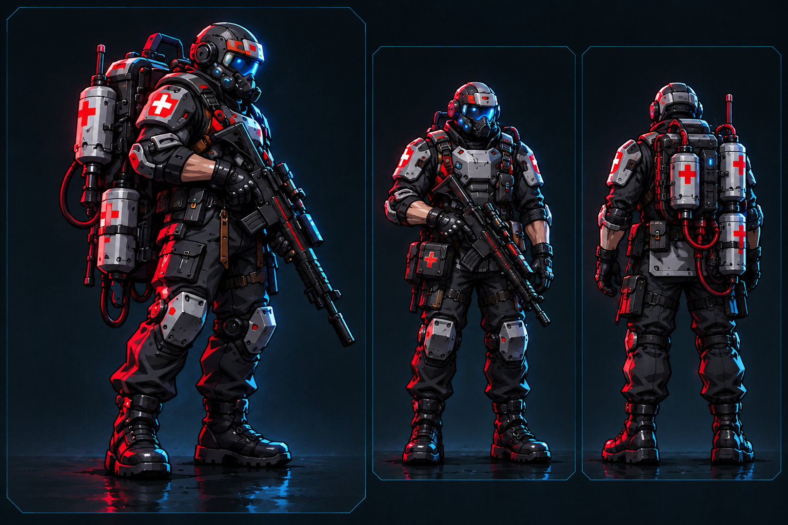</a> | `docs/visual_qa/BULWARK_T1_CONCEPT_TURNAROUND_01_2026-10-25.png` | 1536×1024, RGB PNG | `6261248736618FAB19754F81E90F9E7FF8BA208127DF14F00BE3603014F3D9A3` |
| BULWARK — anatomy | <a href="visual_qa/BULWARK_T1_ANATOMY_TURNAROUND_01_2026-10-25.png">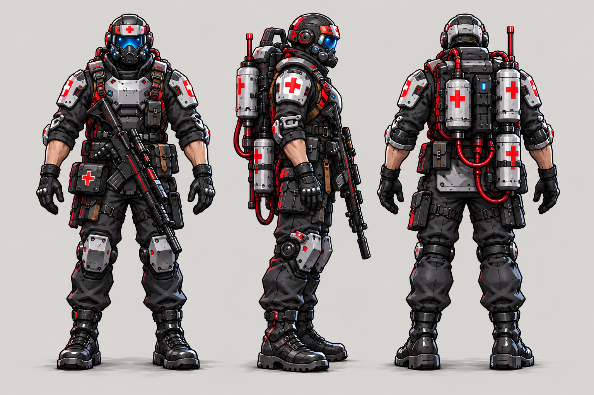</a> | `docs/visual_qa/BULWARK_T1_ANATOMY_TURNAROUND_01_2026-10-25.png` | 1536×1024, RGB PNG | `E297686A8B52A3177E3818185B7D9B56A64284CBFFE459F96A1E9530A5EBDA61` |
| CIPHER — concept | <a href="visual_qa/CIPHER_T1_CONCEPT_TURNAROUND_01_2026-10-25.png">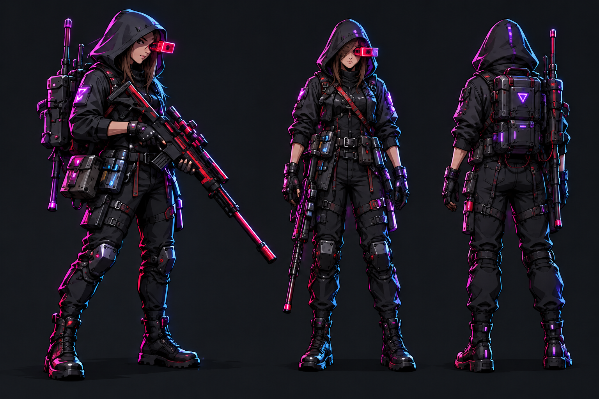</a> | `docs/visual_qa/CIPHER_T1_CONCEPT_TURNAROUND_01_2026-10-25.png` | 1536×1024, RGB PNG | `62B714E4F3C793D70AB04541A743FDBCD845B551D2574AA271859F6A01F35C5D` |
| CIPHER — anatomy | <a href="visual_qa/CIPHER_T1_ANATOMY_TURNAROUND_01_2026-10-25.png">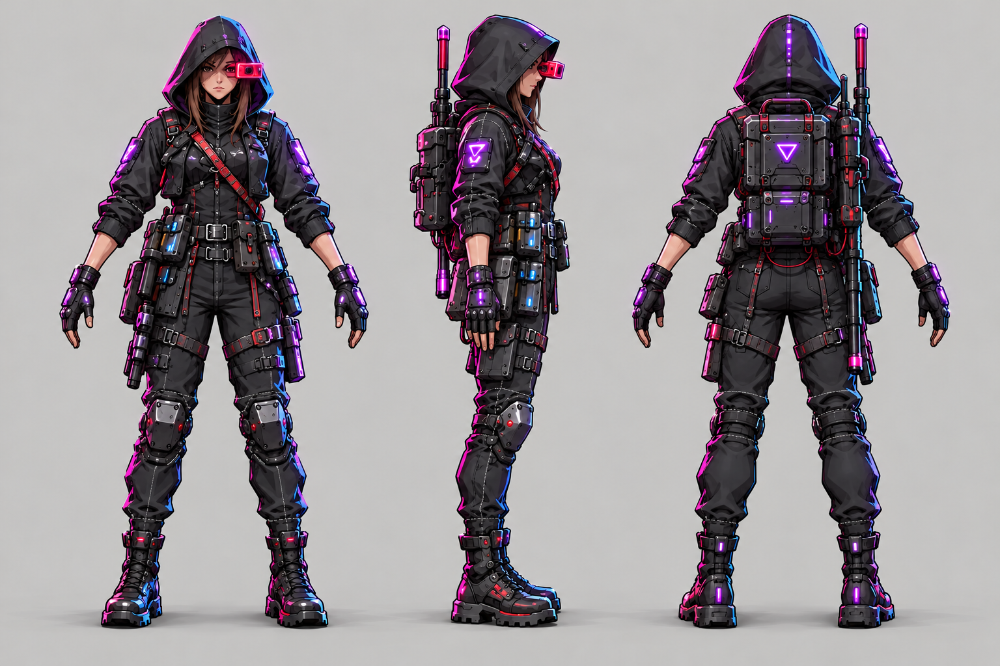</a> | `docs/visual_qa/CIPHER_T1_ANATOMY_TURNAROUND_01_2026-10-25.png` | 1536×1024, RGB PNG | `05C2F08BAB92A0BB68326D77F878EAF90C03B03BD83B88599D9DC35C1E5E6686` |
| SPARK — concept | <a href="visual_qa/SPARK_T1_CONCEPT_TURNAROUND_01_2026-10-25.png">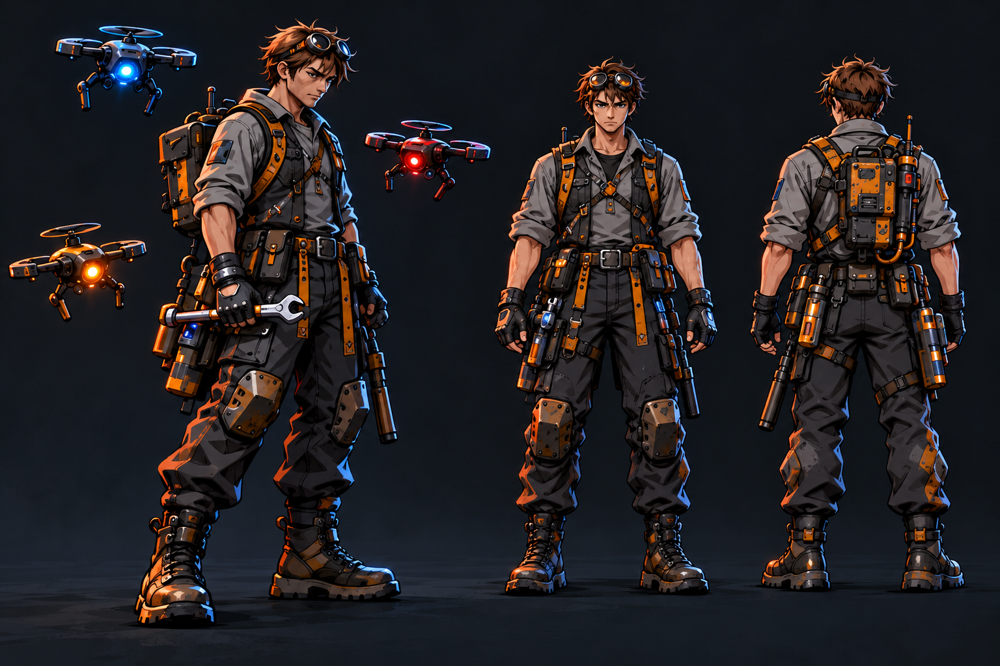</a> | `docs/visual_qa/SPARK_T1_CONCEPT_TURNAROUND_01_2026-10-25.png` | 1536×1024, RGB PNG | `344C81C49194FCBFFF904CF9BF7A48BB66E08DDE3CF4F2CF3EE9253B7C206F0C` |
| SPARK — anatomy | <a href="visual_qa/SPARK_T1_ANATOMY_TURNAROUND_01_2026-10-25.png">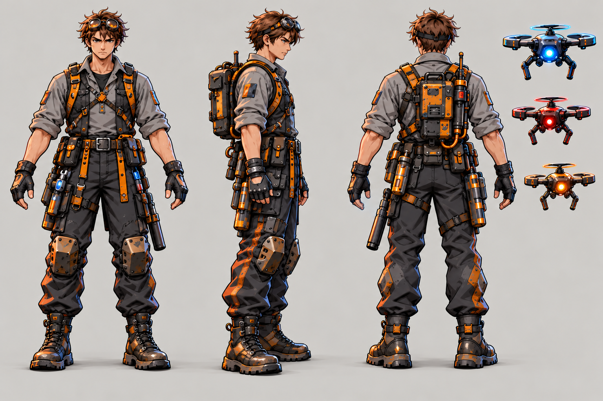</a> | `docs/visual_qa/SPARK_T1_ANATOMY_TURNAROUND_01_2026-10-25.png` | 1536×1024, RGB PNG | `596753B13ABB84BD1A663B51AAB7436126783423706F24A5BA297A236CACD139` |
| SPECTER — concept | <a href="visual_qa/SPECTER_T1_CONCEPT_TURNAROUND_01_2026-10-25.png">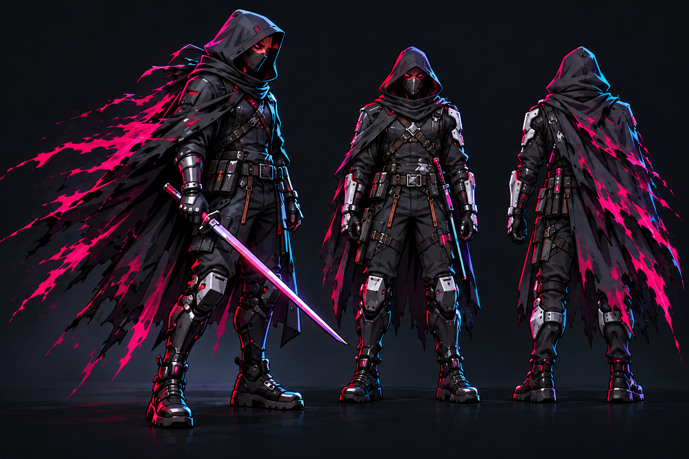</a> | `docs/visual_qa/SPECTER_T1_CONCEPT_TURNAROUND_01_2026-10-25.png` | 1536×1024, RGB PNG | `09E04F092934BBE881F19D0B0AF2827FCB9C145A433BABD1E73F34E89980BD50` |
| SPECTER — anatomy | <a href="visual_qa/SPECTER_T1_ANATOMY_TURNAROUND_01_2026-10-25.png">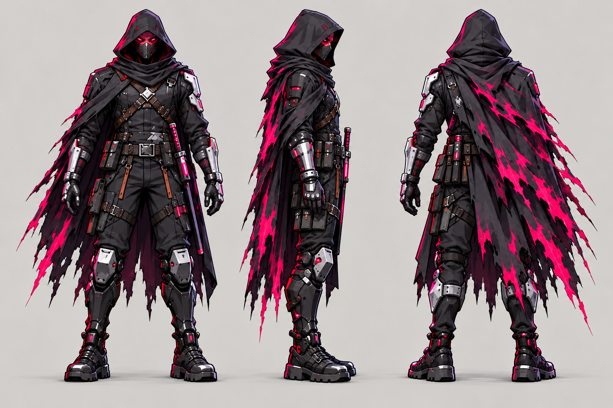</a> | `docs/visual_qa/SPECTER_T1_ANATOMY_TURNAROUND_01_2026-10-25.png` | 1536×1024, RGB PNG | `97FA4F8ABB8800B9B60588376C665A9EC90A3F446187D8A82FE412409BE044E3` |
| IRONCLAD — concept | <a href="visual_qa/IRONCLAD_T1_CONCEPT_TURNAROUND_01_2026-10-25.png">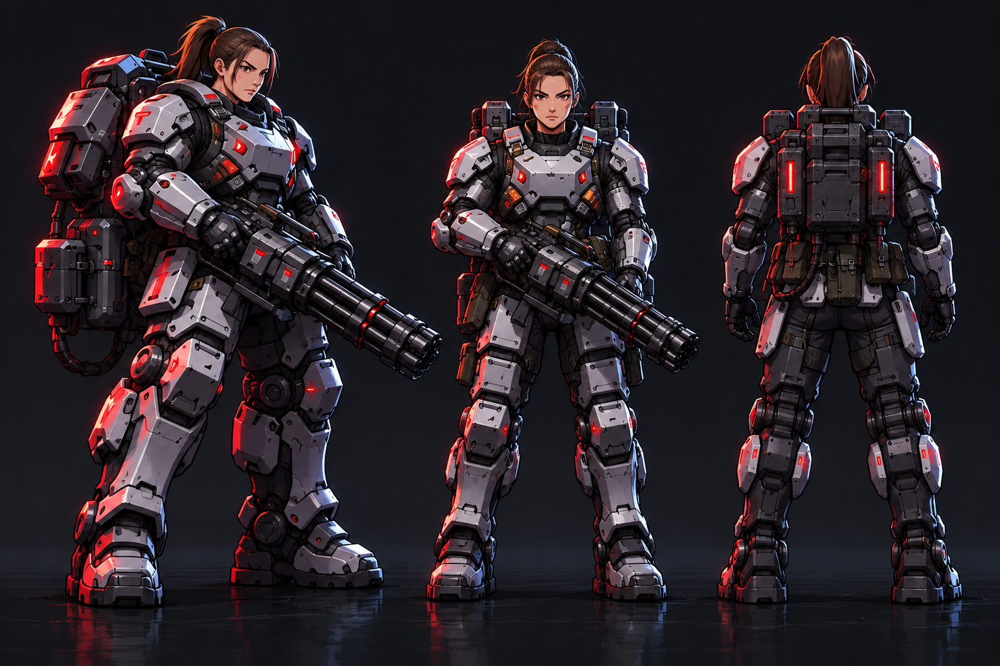</a> | `docs/visual_qa/IRONCLAD_T1_CONCEPT_TURNAROUND_01_2026-10-25.png` | 1536×1024, RGB PNG | `0914340AD7C5D0635D4FA715191C26108EE364DC76E8921F237A8831C071259D` |
| IRONCLAD — anatomy | <a href="visual_qa/IRONCLAD_T1_ANATOMY_TURNAROUND_01_2026-10-25.png">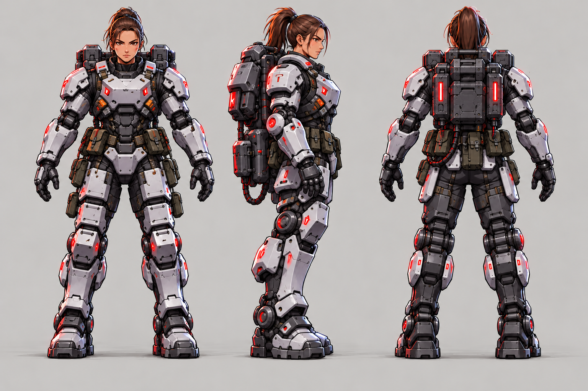</a> | `docs/visual_qa/IRONCLAD_T1_ANATOMY_TURNAROUND_01_2026-10-25.png` | 1536×1024, RGB PNG | `079FEBBFB03A67B104322ECC7F350F1E060EB8157FE4D23055F981985D26434D` |
| STITCH — concept | <a href="visual_qa/STITCH_T1_CONCEPT_TURNAROUND_01_2026-10-25.png">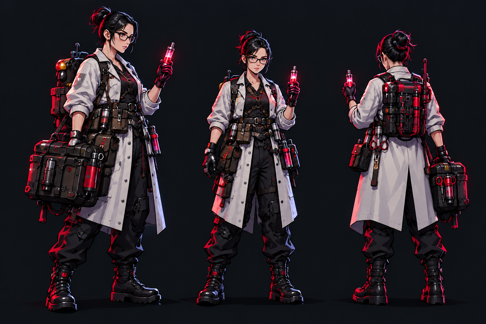</a> | `docs/visual_qa/STITCH_T1_CONCEPT_TURNAROUND_01_2026-10-25.png` | 1536×1024, RGB PNG | `4737BACF562ABEB5725343F80B7D72B4525C64F5327B18ABCD8109626303BB2F` |
| STITCH — anatomy | <a href="visual_qa/STITCH_T1_ANATOMY_TURNAROUND_01_2026-10-25.png">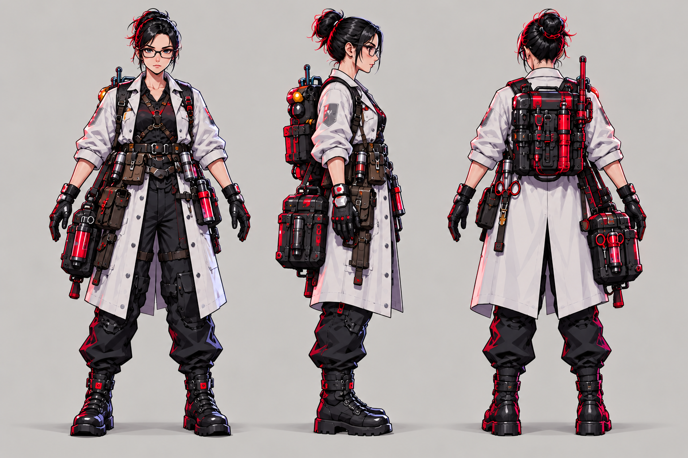</a> | `docs/visual_qa/STITCH_T1_ANATOMY_TURNAROUND_01_2026-10-25.png` | 1536×1024, RGB PNG | `3943220FC15DD6B33A0E30A544E4EA12FD28E7FF68FA566F20BE5F6C40FFB772` |
| RECOIL — concept | <a href="visual_qa/RECOIL_T1_CONCEPT_TURNAROUND_01_2026-10-25.png">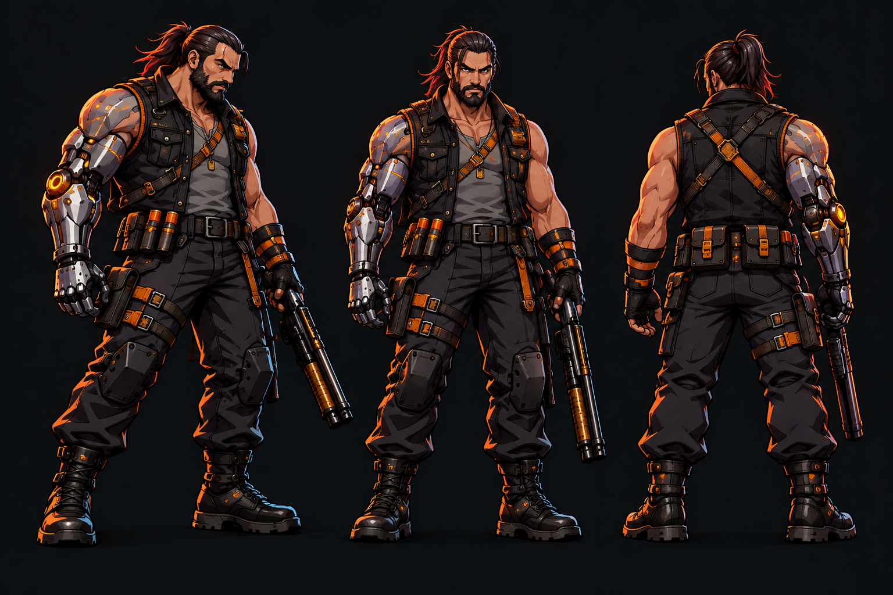</a> | `docs/visual_qa/RECOIL_T1_CONCEPT_TURNAROUND_01_2026-10-25.png` | 1536×1024, RGB PNG | `58F4622266D21E51EA79838AFD20C580E9690AEF74909679CBDF1F78B40D2B25` |
| RECOIL — anatomy | <a href="visual_qa/RECOIL_T1_ANATOMY_TURNAROUND_01_2026-10-25.png">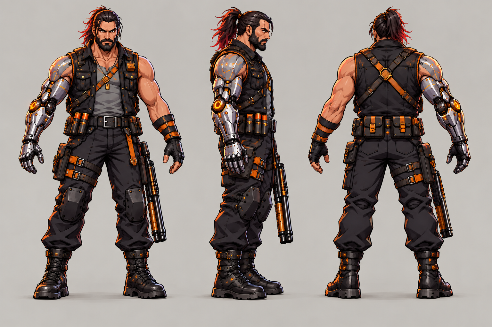</a> | `docs/visual_qa/RECOIL_T1_ANATOMY_TURNAROUND_01_2026-10-25.png` | 1536×1024, RGB PNG | `4451CE8CD7FA4BC09FDE6E307C66BA80287F39438E5BD7FB8A5801649ACA5941` |
| ECHO — concept | <a href="visual_qa/ECHO_T1_CONCEPT_TURNAROUND_01_2026-10-25.png">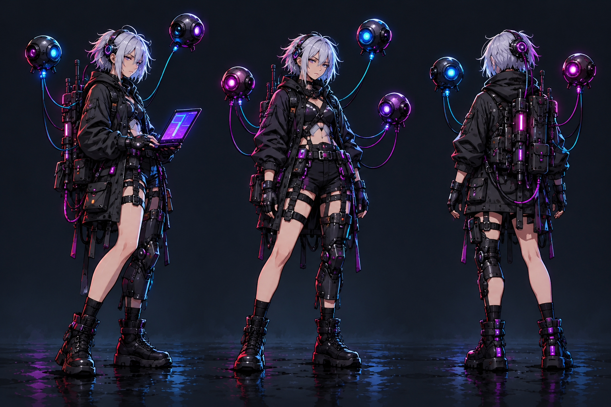</a> | `docs/visual_qa/ECHO_T1_CONCEPT_TURNAROUND_01_2026-10-25.png` | 1536×1024, RGB PNG | `1D537FFA3B1F8FFC4D7D644D1F002BEF4E5F0CE22F0C97B394A1C51F1E81038D` |
| ECHO — anatomy | <a href="visual_qa/ECHO_T1_ANATOMY_TURNAROUND_01_2026-10-25.png">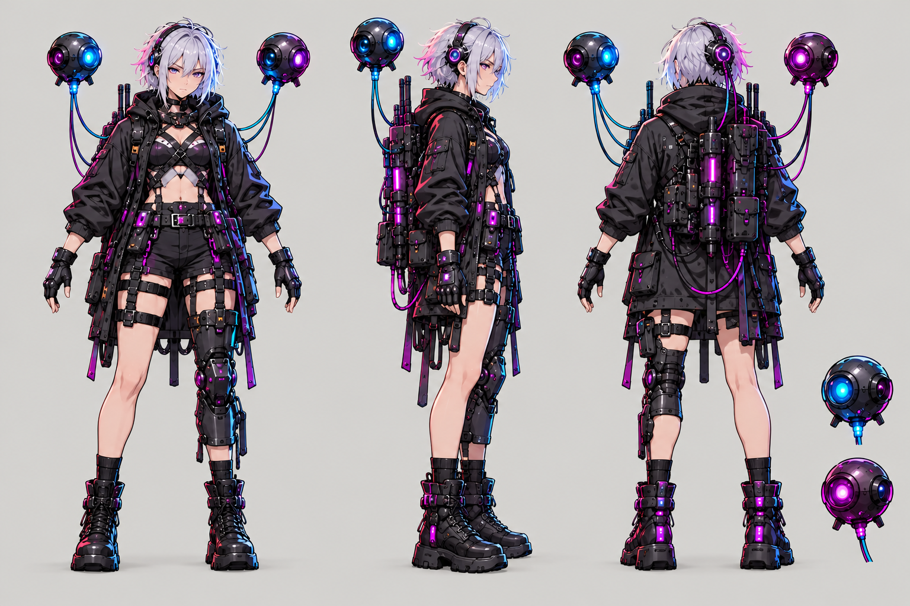</a> | `docs/visual_qa/ECHO_T1_ANATOMY_TURNAROUND_01_2026-10-25.png` | 1536×1024, RGB PNG | `4B46F2241F6805FF0634EB9691F2701253851A64596764B9D0B1DC4FA9141F40` |
| VECTOR — concept | <a href="visual_qa/VECTOR_T1_CONCEPT_TURNAROUND_01_2026-10-25.png">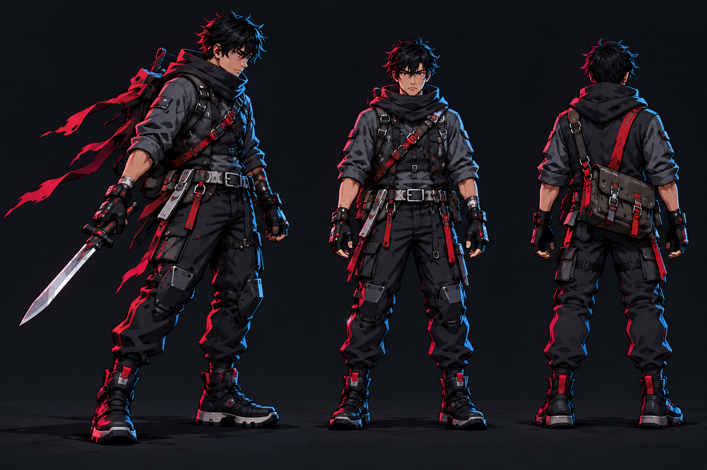</a> | `docs/visual_qa/VECTOR_T1_CONCEPT_TURNAROUND_01_2026-10-25.png` | 1536×1024, RGB PNG | `46435C7CBDD1583D40A572B75D7E17BD2BD7548A84FBC447CCAFD472C968313F` |
| VECTOR — anatomy | <a href="visual_qa/VECTOR_T1_ANATOMY_TURNAROUND_01_2026-10-25.png">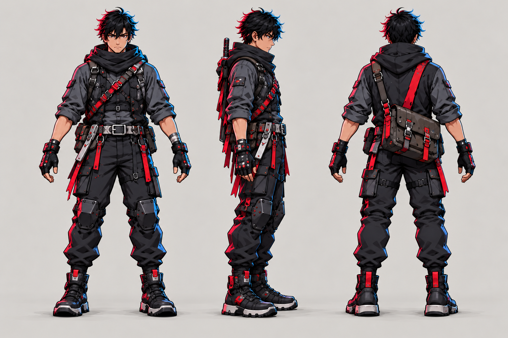</a> | `docs/visual_qa/VECTOR_T1_ANATOMY_TURNAROUND_01_2026-10-25.png` | 1536×1024, RGB PNG | `36754CD9D936520B453D4B227CED4007962F711D9A294B2A9FEBAD137F381307` |
| DEADLOCK — concept | <a href="visual_qa/DEADLOCK_T1_CONCEPT_TURNAROUND_01_2026-10-25.png">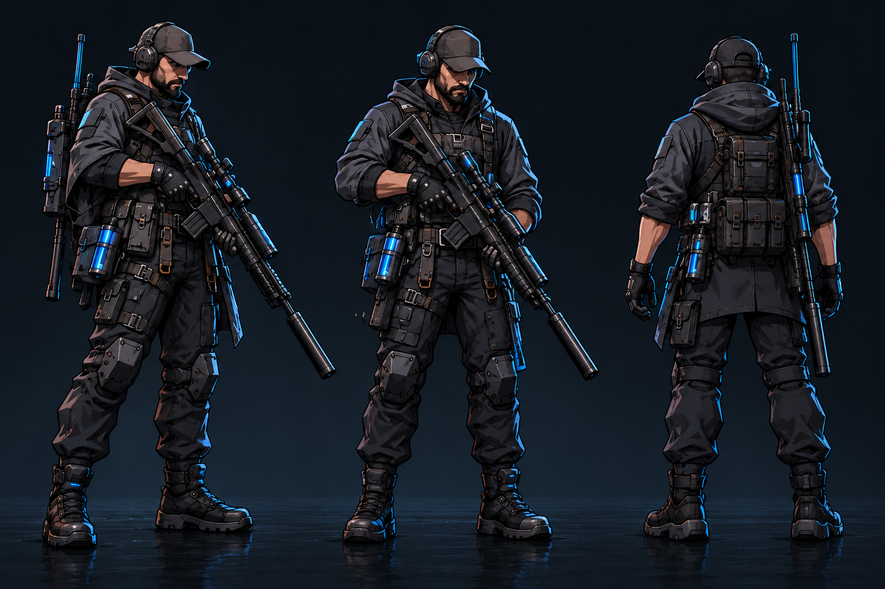</a> | `docs/visual_qa/DEADLOCK_T1_CONCEPT_TURNAROUND_01_2026-10-25.png` | 1536×1024, RGB PNG | `BB6737FEB9F031C231C12367D651C29AE00033D2281E045B6804D3E120F0EE5D` |
| DEADLOCK — anatomy | <a href="visual_qa/DEADLOCK_T1_ANATOMY_TURNAROUND_01_2026-10-25.png">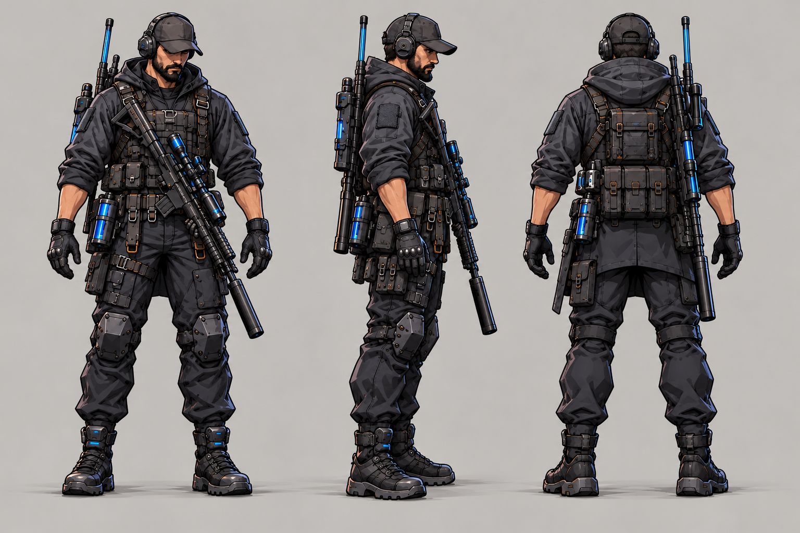</a> | `docs/visual_qa/DEADLOCK_T1_ANATOMY_TURNAROUND_01_2026-10-25.png` | 1536×1024, RGB PNG | `40727638B403CF01F88365F71A6E2AEF4B9DDD2A35A7E08D0C078158ACC67DBA` |
| GLITCH — concept | <a href="visual_qa/GLITCH_T1_CONCEPT_TURNAROUND_01_2026-10-25.png">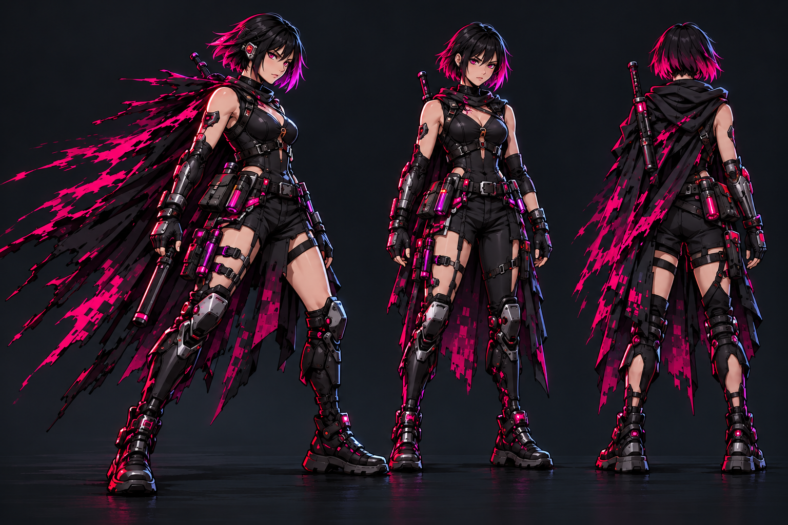</a> | `docs/visual_qa/GLITCH_T1_CONCEPT_TURNAROUND_01_2026-10-25.png` | 1536×1024, RGB PNG | `988F561A086BD9A46AF1167ADB63242CF592616B954D0B25A81AD613B1247177` |
| GLITCH — anatomy | <a href="visual_qa/GLITCH_T1_ANATOMY_TURNAROUND_01_2026-10-25.png">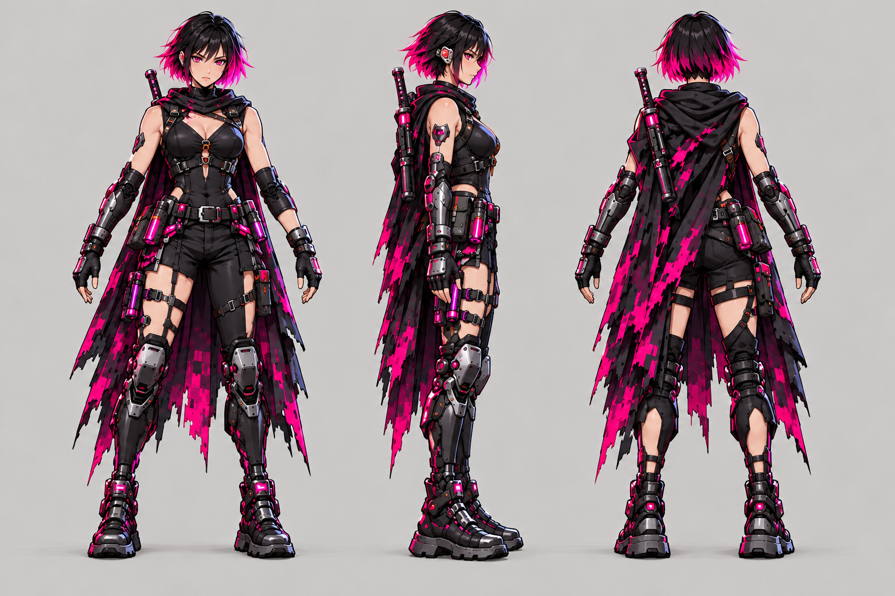</a> | `docs/visual_qa/GLITCH_T1_ANATOMY_TURNAROUND_01_2026-10-25.png` | 1536×1024, RGB PNG | `91273E75E58E4C0AA17D745D59574AEF4E03FB791A57A62570F241DE65AB0EF1` |

## BREAKER — approved local Tier I reference

This is a single-view exception to the 11 concept/anatomy pairs. The profile target is approved for visible Tier I appearance only. It retains a background and is not an animation-ready sprite or extraction-ready transparent layer. The linked specification is a local offline reconstructed handoff; it is useful as a production reference, but it is not a verbatim canonical export. If it conflicts with current project decisions, follow `docs/DESIGN_DECISIONS.md` and reconcile the source rather than guessing.

| Reference | Linked file | Project-relative path | Dimensions / format | SHA-256 (current local file) | Status |
|---|---|---|---|---|---|
| BREAKER — profile target |  | `assets/characters/breaker/tier_01_drafts/BREAKER_T1_profile_rebuild_candidate_01.png` | 1024×1536, RGBA PNG | `651732E043C64204EBFCA92532C62AF0D8BA46443642268902BED8FF5954319C` | Approved visual target only; no parts, pivot, rig, or runtime approval. |
| BREAKER — production specification | [Open the local specification](../migration_package/drive_assets/Breaker_Tier1_Godot_Production_Spec.md) | `migration_package/drive_assets/Breaker_Tier1_Godot_Production_Spec.md` | Markdown; pixel dimensions not applicable; 6,371 bytes | `AE8B93195322A557C5F0B97BB51DE4ED8D81C42F140472D50CC46FB9E4148293` | Approved visual direction/specification in the offline reconstructed handoff; not a source image. |

## Integrity check and exceptions

- All 23 expected PNG files were found at the exact names and paths listed; current dimensions match the local approved records (1536×1024 RGB for the eleven concept/anatomy pairs; 1024×1536 RGBA for the BREAKER profile target). The BREAKER specification is present as Markdown.
- No missing file or path/dimension mismatch was found. The local approval records reviewed do not store prior SHA-256 values for these files; the hashes above are current local fingerprints, not a claim of comparison with a previously approved hash.
- The anatomy references are approved guides to visible appearance, not production sprites. The BREAKER profile target is approved appearance only. The specification is from an offline reconstructed package, so it does not supersede current local decisions.
- No image bytes were edited or re-encoded. No contact sheet, extracted part, candidate, ORA, runtime file, or test was created or changed.
